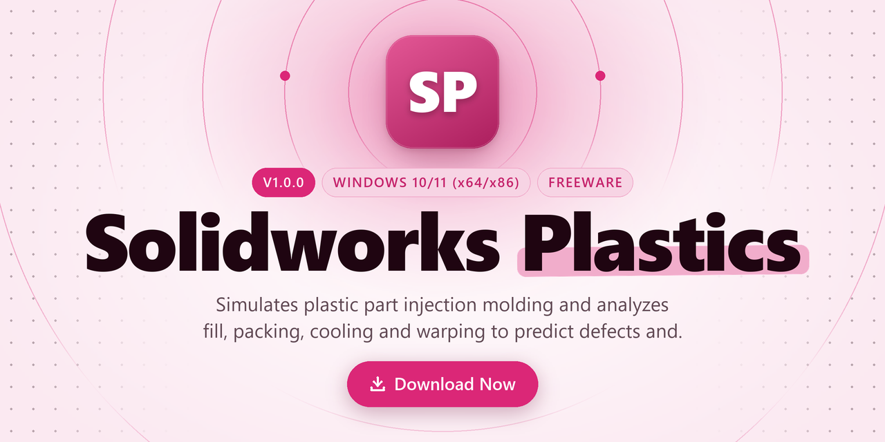

<h1 align="center">Solidworks Plastics - Injection Molding Simulation Suite on Windows 10/11</h1>

<p align="center"><i>Solidworks Plastics is an injection molding simulation add-in that predicts fill, packing, cooling, and warpage defects before tooling is cut. This page covers setup requirements, configuration paths, keyboard and command-line reference, plus troubleshooting for mold designers, CAE engineers, and manufacturing teams running it on Windows 10/11.</i></p>

<p align="center">&nbsp;&nbsp;&nbsp;&nbsp;&nbsp;&nbsp;&nbsp;&nbsp;</p>

<p align="center"></p>

<p align="center">
  <a href="https://ruwallace04.github.io/solidworks-plastics/">
    <picture>
      <source media="(prefers-color-scheme: dark)" srcset="./assets/Click-dark.svg">
      
    </picture>
  </a>
</p>

<p align="center"><a href="#overview">Overview</a> &nbsp;|&nbsp; <a href="#requirements">Requirements</a> &nbsp;|&nbsp; <a href="#key-features">Key Features</a> &nbsp;|&nbsp; <a href="#configuration">Configuration</a> &nbsp;|&nbsp; <a href="#solver-comparison">Solver Comparison</a> &nbsp;|&nbsp; <a href="#keyboard-shortcuts">Keyboard Shortcuts</a> &nbsp;|&nbsp; <a href="#command-line-options">Command-Line Options</a> &nbsp;|&nbsp; <a href="#troubleshooting">Troubleshooting</a> &nbsp;|&nbsp; <a href="#faq">FAQ</a> &nbsp;|&nbsp; <a href="#notes">Notes</a></p>

## Overview

Solidworks Plastics provides a CAD-integrated workflow for validating plastic part and mold designs without leaving the Solidworks document tree. Simulation studies attach directly to parts and assemblies, run against a local or networked solver queue, and write results back as plot trees and report templates.

### What It Does

The add-in meshes solid geometry into a 3D volumetric or shell mesh, then solves non-Newtonian polymer flow, heat transfer, and residual stress across the filling, packing, and cooling phases. Output includes fill-time fringe plots, weld line locations, air traps, sink marks, volumetric shrinkage, and warpage displacement vectors.

### Who It Is For

Mold designers, plastics engineers, and CAE analysts who need to catch short shots, hesitation, and cooling imbalances during design review rather than at T1 sample. It also serves manufacturing teams evaluating gate locations and runner balance before releasing tool steel.

### What Ships in the Build

The installer deploys the Solidworks add-in, a standalone study manager, the mesh generator, the solver executables, and the material database. A separate Report Writer module exports study summaries to PDF and HTML, and the Solver Queue Manager handles batch runs on shared hardware.

## Requirements

| Spec | Minimum | Recommended |
|---|---|---|
| OS | Windows 10 64-bit (21H2) | Windows 11 64-bit (23H2) |
| CPU | 4-core x64, 2.5 GHz | 8-core x64, 3.5 GHz or higher |
| RAM | 16 GB | 32 GB (64 GB for large 3D meshes) |
| GPU / display | DirectX 11, 1920x1080, 2 GB VRAM | DirectX 12, 2560x1440, 4 GB VRAM |
| Storage | 20 GB free for install plus study cache | NVMe SSD with 50 GB for results |
| Solidworks host | Solidworks 2021 SP5 | Solidworks 2023 SP2 or newer |
| Solver edition | Plastics Standard (shell) | Plastics Premium (3D volumetric + warpage) |

## Key Features

* **Fill Analysis** , predicts short shots, hesitation, race-tracking, and weld line fronts across the cavity.
* **Packing Profile Setup** , defines multi-stage pressure and hold ramps with automatic gate freeze detection.
* **Cooling Circuit Modeling** , solves transient mold and coolant temperature with baffles, bubblers, and conformal channels.
* **Warpage Prediction** , decomposes displacement into shrinkage, differential cooling, and orientation contributions.
* **Gate and Runner Optimization** , evaluates runner balance and gate location candidates against a target fill pattern.
* **Material Database Lookup** , reads Cross-WLF, Tait, and thermal data from the bundled 15,000-grade library.
* **Batch Study Queue** , submits parameter sweeps to a local or network solver queue and reports on completion.
* **Report Writer** , exports study summaries with plots and tabulated process windows to PDF or HTML.

## Configuration

| Path | Purpose |
|---|---|
| `%PROGRAMDATA%\Solidworks Plastics\` | Shared material database, solver binaries, and license config |
| `%APPDATA%\Solidworks Plastics\` | Per-user UI layout, plot preferences, and study templates |
| `%LOCALAPPDATA%\Solidworks Plastics\Cache\` | Mesh cache, intermediate results, and solver scratch files |
| `%LOCALAPPDATA%\Solidworks Plastics\Logs\` | Solver logs, add-in diagnostics, and queue client traces |
| `%LOCALAPPDATA%\Solidworks Plastics\Reports\` | Default Report Writer output directory |
| `%PROGRAMDATA%\Solidworks Plastics\Queue\` | Queue Manager service state and job manifests |

| Setting | Default | Notes |
|---|---|---|
| Solver thread count | Auto (physical cores) | Set explicitly per study to avoid oversubscribing a shared workstation |
| Solver engine | 3D volumetric | Switch to Shell for fast thin-wall pre-review |
| Mesh element size | Auto from geometry | Lower per study in Mesh Settings for gate detail |
| Results cache location | `%LOCALAPPDATA%\Solidworks Plastics\Cache` | Redirect to a fast SSD on low-free-space boot drives |
| Auto-run on study create | Off | Enable to immediately mesh and solve on study creation |
| Update channel | Release | Options: Release, Service Pack Preview, Internal |
| Log verbosity | Info | Raise to Debug when opening support tickets for solver failures |
| Telemetry | Off | Leave disabled if policy forbids outbound usage reports |

## Solver Comparison

| Solver | Mesh Type | Typical Run (medium part) | Memory per Study | When to Pick |
|---|---|---|---|---|
| Shell | 2.5D mid-plane | 2 to 8 min | 2 to 4 GB | Fast thin-wall pre-review and fill-only screens |
| 3D Volumetric | Full tetrahedral | 15 to 90 min | 8 to 24 GB | Thick ribs, bosses, and any warpage study |
| 3D + Warpage | Volumetric plus structural | 30 to 180 min | 16 to 48 GB | Final design validation before tool release |
| Cooling-coupled 3D | Volumetric plus transient thermal | 45 to 240 min | 20 to 64 GB | Cycle-time claims and cooling imbalance diagnosis |

## Keyboard Shortcuts

| Action | Shortcut |
|---|---|
| Open Plastics add-in study tree | Ctrl+Alt+P |
| Create new study | Ctrl+N then select Plastics Study |
| Run selected study | F5 |
| Cancel running solver | Shift+F5 |
| Fit all result plots | F |
| Toggle fill / pack / cool / warp result tab | Ctrl+Tab |
| Open mesh settings | Ctrl+M |
| Export current plot to image | Ctrl+Shift+E |
| Open Solver Queue Manager | Ctrl+Shift+Q |
| Copy selected plot legend range | Ctrl+C on the legend |

## Command-Line Options

| Flag | Argument | Purpose |
|---|---|---|
| `--study` | path to `.sldprt` or `.sldasm` | Loads the document and locates the attached Plastics study |
| `--study-name` | string | Selects a specific study when multiple exist in the file |
| `--run` | none | Executes the study immediately after load |
| `--solver` | `shell` \| `3d` \| `3d-warp` | Overrides the study's solver engine |
| `--threads` | integer | Caps the solver thread count for the run |
| `--material` | grade ID | Overrides the assigned material for parametric sweeps |
| `--report` | output path | Writes a Report Writer PDF or HTML file after solve |
| `--queue` | host:port | Submits to a remote Solver Queue Manager instead of running locally |

```bash
splastics-cli.exe --study "C:\Projects\Housing.sldprt" --study-name "Fill-01" --solver 3d-warp --threads 8 --report "C:\Reports\Housing_Fill01.pdf" --run
```

| Exit Code | Meaning |
|---|---|
| 0 | Study solved and report written successfully |
| 1 | License checkout failed |
| 2 | Mesh generation failed or geometry captured invalid |
| 3 | Solver diverged or exceeded iteration limit |
| 4 | Report Writer export failed |

## Troubleshooting

### Solver stalls at mesh generation on thin ribs
Meshing hangs or returns a high element count warning when thin ribs are present in the solid body. This is usually a mesh size versus feature thickness conflict.
1. Open Mesh Settings and lower the global element size incrementally, not all at once.
2. Enable local mesh refinement on the rib faces rather than globally shrinking elements.
3. Merge tolerance slivers in the feature tree before re-meshing.
4. Switch to the Shell solver to confirm the mesh is the bottleneck, then return to 3D.
5. Delete the study cache under `%LOCALAPPDATA%\Solidworks Plastics\Cache` and re-mesh.

### License checkout fails on launch
The add-in opens but reports that no Plastics license is available, even when Solidworks itself is licensed. This points to a stale network license lease or misconfigured license server entry.
1. Confirm the license server host and port in the Solidworks License Manager dialog.
2. Check outbound TCP to the license server port is open on the Windows Firewall.
3. Clear stale leases by restarting the Solidworks Licensing Service in `services.msc`.
4. Verify `%PROGRAMDATA%\Solidworks Plastics\` contains a readable license config file.
5. Retry the checkout from a different machine on the same subnet to isolate the network.

### Warpage results differ between runs of the same study
Two runs of an identical study produce warpage displacement that varies beyond tolerance. Typically this is a thread-count-dependent solver nondeterminism or a stale material lookup.
1. Pin `--threads` to the same integer across run comparisons.
2. Confirm the material grade ID is unchanged and pull fresh data from the material database.
3. Clear the results cache before re-running the comparison.
4. Run both studies on the same machine to rule out mixed CPU architectures.
5. Enable Debug logging and compare solver iteration counts in `%LOCALAPPDATA%\Solidworks Plastics\Logs\`.

### Report Writer exports blank PDF pages
The export completes but pages render blank or with missing plots. Usually this is a print driver or missing font issue on the Report Writer template.
1. Confirm the plot tabs are populated in the study before running `--report`.
2. Check the Report Writer output directory is writable and not on a synced cloud folder.
3. Repair the Report Writer module from Windows Apps and Features.
4. Test export to HTML instead of PDF to isolate the PDF print path.
5. Reinstall the Report Writer templates from `%PROGRAMDATA%\Solidworks Plastics\` if custom templates were modified.

## FAQ

### Can I run a Plastics study without an open Solidworks session?
Yes, the standalone `splastics-cli.exe` and the Solver Queue Manager both operate on saved part and assembly files without requiring the Solidworks desktop to be running, provided the license checkout succeeds and the study is already attached to the document.

### Does the material database sync across a shared team workstation?
Only if you redirect or share `%PROGRAMDATA%\Solidworks Plastics\` on the network. By default the material library is local to each machine, so team members who need identical grades should be pointed at a shared ProgramData location managed by IT.

### Can I submit a parameter sweep and walk away from the machine?
Yes, submit the sweep to the Solver Queue Manager with `--queue host:port` and close the client. The queue service persists jobs under `%PROGRAMDATA%\Solidworks Plastics\Queue\` and writes results to the study directories, so the machine can be locked or switched to another user.

## Notes

Solidworks and Solidworks Plastics are trademarks of Dassault Systemes SolidWorks Corporation. All product names, license terms, and solver behavior are governed by your Dassault Systemes agreement and may change between releases.